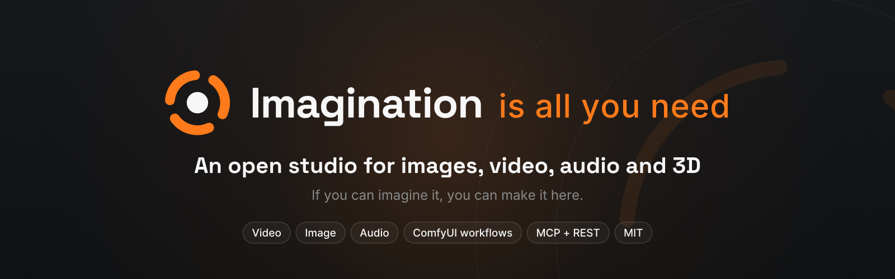

<p align="center"><a href="https://x.com/IIAYNAPP"></a></p>

<p align="center"><b>A home for your imagination.</b><br>An open-source studio for images, video, audio and 3D.</p>

<p align="center">🎬 <a href="https://x.com/IIAYNAPP">Watch the demo film and tutorials on X</a></p>

<p align="center">
  <a href="https://github.com/sytesims/imagination-is-all-you-need/actions/workflows/ci.yml"></a>
  <a href="LICENSE"></a>
  <a href="workflows/README.md"></a>
  <a href="docs/MCP.md"></a>
</p>

It all started with Comfy's **#OpenSourceHiggsfield** challenge.

An image becomes a character. A character steps into a scene. A camera move becomes a shot, and a few shots become a film.

**Imagination Is All You Need** brings image, video, audio and 3D tools into one creative space. Run it on your computer, open it in your browser, and move between ideas without starting over each time.

### A note from me

I wanted a place to follow an idea from the first picture to the finished film, with the models and workflows visible along the way. This is an early version of that place. Try the examples, make something of your own, and tell me what gets in your way.

## What will you make?

- **A character with a story.** Create a picture, turn it into a 3D model, stage a scene and give it motion.
- **A shot you've already imagined.** Place the camera and actors in **Direct a Shot**, capture a free browser mockup, then guide a supported video render with it.
- **A product in a new light.** Make product shots, edit backgrounds, relight images and try supported garment workflows.
- **A film with its own voice.** Create voiceover, music or sound effects, then bring shots, sound and titles together in the editor.
- **A board full of possibilities.** Arrange references and results on the Canvas; optionally bring an agent into the process.

Start with the bundled **Examples project** to see existing results and how they were made. **Recreate** prepares a workflow and its settings; it never starts a paid run on its own.

Tools depend on the model, route and setup you choose. Canvas and the film editor are in beta; [the feature guide below](#explore-the-studio) gives more detail.

## Start with examples, cloud or your own models

| Start with | What you need |
|---|---|
| **Included examples** | No provider key, GPU or ComfyUI. Browse the bundled Examples project and inspect how results were made. |
| **Cloud generation** | An account and API key for the service you choose. No local ComfyUI or model download is required. Providers bill your account. |
| **Models on your computer** | A compatible running ComfyUI installation, its required model files/custom nodes and suitable hardware. ComfyUI Desktop is optional; a manual installation can also be connected. |

**The app installer installs the app, not ComfyUI or model weights.** Set up external tools separately if you want local generation. The wizard can look for an existing ComfyUI or accept its address.

### Yours to keep. Yours to change.

You have the source, not just a login. If you get stuck, ask an AI coding agent to help: give it access to your local project and point it to [AGENTS.md](AGENTS.md). It can help explain the app, check what your setup is missing, connect an existing ComfyUI, or adapt the interface and workflows to the way you like to create.

Try: **“Read AGENTS.md, help me get this running on my computer, and explain each step before changing anything.”** Or describe a change you'd like to make. What the agent can do depends on the tools and permissions you give it; an ordinary chat cannot automatically access your computer. Keep keys private and ask it to get your approval before large downloads or paid runs.

<a id="quick-start"></a>

## Open your studio

You'll need a current **Node 20, 22 or 24** release and npm; Node 22 or 24 is recommended. Install **ffmpeg and ffprobe** for uploads and media processing. No model connection is needed to browse the included examples.

```text
git clone https://github.com/sytesims/imagination-is-all-you-need.git
cd imagination-is-all-you-need
npm run setup
```

Open the setup link printed in the terminal, normally **http://localhost:5174**, and choose how you want to create. Keep the terminal open while you use the studio; **Ctrl+C** stops it. Closing the browser does not stop the app.

On Windows, use `npm.cmd run setup` if PowerShell selects a blocked `npm.ps1` shim. Do not disable your system's execution policy just to run the app.

Without a model connection, **Generate asks you to connect a key or ComfyUI**. It does not start a free generation. Included examples are existing outputs; the separate mock backend is for development and tests.

Need help getting started? [Install and run](docs/INSTALL.md) covers prerequisites and Windows/macOS instructions. It also includes Docker and advanced setup. Other ports and settings: [Configuration](docs/CONFIGURATION.md).

### Updating

Stop the app (**Ctrl+C**), then run this in the app folder:

```text
npm run update
```

It gets the latest version from GitHub, installs only what changed and lists what's new. Installed version 1.0? It doesn't have this command yet, so the first time run `git checkout package-lock.json`, then `git pull`, then `npm ci` instead. Your library, boards and keys stay as they are. `npm run update -- --check` only tells you if an update is ready. Downloaded the zip instead? See [Updating](docs/INSTALL.md#updating). You can see your version in Settings → Profile.

## Explore the studio

Features depend on the selected model, route and installed prerequisites. Check the model's capabilities and setup status before a run.

| Area | What you can do |
|---|---|
| **Image** | Create and edit images, inpaint, use references, upscale, relight, make character sheets and product shots. Try-on accepts separate person and garment images. |
| **Image to layers** | Separate a supported image into layers, then review or export the results. |
| **Video** | Generate from text/images, use supported first/last-frame or loop workflows, extend, transition, restyle, transfer motion, swap a subject and upscale. |
| **Direct a Shot** | Stage a scene and camera move in browser-based 3D, capture a free mockup, then use it to guide a supported render workflow. [How it works](docs/PLAN-A-SHOT.md). |
| **Audio** | Voiceover, music, sound effects, soundtrack, voice-change and translation workflows. |
| **3D** | Image-to-3D generation, turntables and scene staging; supported formats and models are shown in the app. |
| **Canvas · beta** | Arrange ideas and results on a connected board; an MCP client can read and edit drafts and prepare generation proposals. |
| **Editor · beta** | Arrange shots, joins, sound and titles into a film. |
| **Workflows and models** | Browse supported recipes, model capabilities, run locations, setup requirements, sources and licences. |
| **Assets and brands** | Organize results in projects, reuse them in compatible tools, and apply saved brand settings to supported exports. |
| **Export and sharing** | Download results and prepare supported sharing files/captions. A link to a locally running app is not automatically a public share link. |

The home page's **Explore** showcase follows examples made with the app. Models and run information stay visible, with estimates distinguished from reported actual costs. Supported generation uses ComfyUI workflows or model-specific API adapters; browser editing and media finishing are separate operations.

## Agents and developers

The included **MCP server** lets compatible clients discover generation tools, inspect inputs, request quotes, submit permitted runs, monitor jobs and reuse outputs. Optional Canvas tools connect agent work to a browser board. The [included skills](docs/MCP-SKILLS.md) describe multi-step creative workflows.

Paid generation requests use quotes and the configured permission/budget controls. **A quote is not human approval.** Canvas proposals use the web **Go** action; direct MCP calls follow their separately configured permissions. Review those settings before granting an agent access to a funded account.

Film-editor and project-management operations are not all exposed as dedicated MCP tools; consult the REST API for the available operations. Do not assume complete UI/MCP parity.

- [MCP connection, transports and permissions](docs/MCP.md)
- [REST API](docs/API.md) · [API quick start](docs/API-QUICKSTART.md)
- [Workflow sources and templates](workflows/README.md)

The default development services are web **5174**, API **8787** and MCP **8788**. The app is intended to start on loopback; remote access needs a separately reviewed network/authentication setup. Do not expose a key-enabled local development instance to the internet.

## Compatibility and verification

This is an **early public preview**. The app has been checked locally on macOS with Node 24 and isolated keyless mock data. Native Windows browser/GPU use and every model/provider combination have not been verified.

The [startup CI](https://github.com/sytesims/imagination-is-all-you-need/actions/workflows/ci.yml) has passed installation, build and API/web startup on **Windows, macOS and Linux**, using Node 20. The badge tracks the latest run. Startup checks are not browser, GPU, real-provider or every-workflow verification.

Local model availability depends on hardware, ComfyUI version, nodes and model files. A successful cloud run does not verify the same model on a local GPU. The workflow documentation distinguishes **Ran** from **Built**; see [models and providers](docs/PROVIDERS-AND-MODELS.md) and [local hardware requirements](docs/LOCAL-MODELS-AND-HARDWARE.md).

## Licences and credits

Our code is **[AGPL-3.0-or-later](LICENSE)**, with the tldraw extra permission described in [NOTICE](NOTICE). tldraw also retains its [own licence](licenses/tldraw-LICENSE.md); check its requirements before production deployment.

Generative model weights are not bundled. The app does include browser-analysis assets such as its YAMNet audio classifier, with their own notices. Models, workflows, nodes, dependencies and sample assets retain their own terms and attribution requirements. See [LICENSES.md](LICENSES.md), [workflow licences](workflows/LICENSES.md), [attribution](docs/ATTRIBUTION.md) and [asset credits](ASSETS-CREDITS.md). Review the actual model/variant's licence rather than assuming all open weights use the same terms.

Our workflow sources include Comfy-Org templates, credited community recipes and our own graphs. The included examples and sample assets have their credits recorded separately. The earlier Canvas demo narration used Kokoro-82M, stock voice `af_heart`; see [asset credits](ASSETS-CREDITS.md) for the replacement recording.

## Help and contributing

[Troubleshooting](docs/TROUBLESHOOTING.md) · [Contributing](docs/CONTRIBUTING.md) · [Security reporting](SECURITY.md)

For a bug report, include your OS, browser, Node version, GPU if relevant, whether you used cloud or your own ComfyUI, and reproducible steps. **Never include keys, private prompts or personal media without checking what you are sharing.** AI coding assistants should read [AGENTS.md](AGENTS.md).

---

Made for Comfy's **#OpenSourceHiggsfield** challenge. Imagination Is All You Need is an independent project, not affiliated with or endorsed by Higgsfield.
