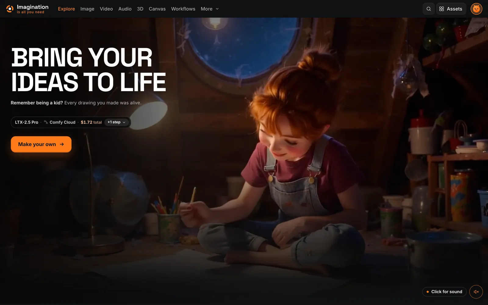
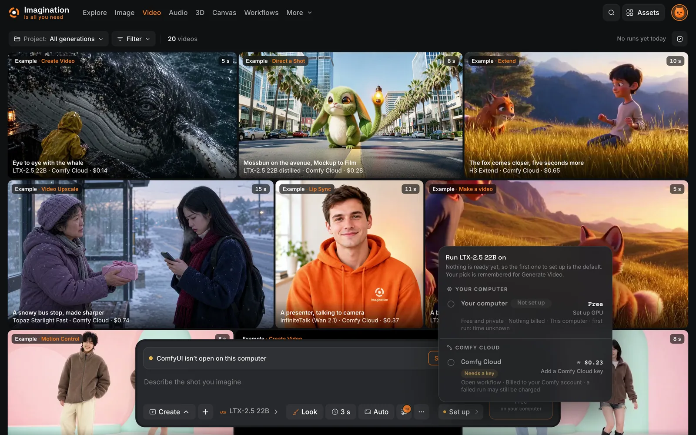
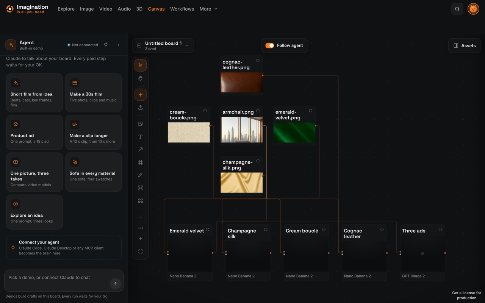
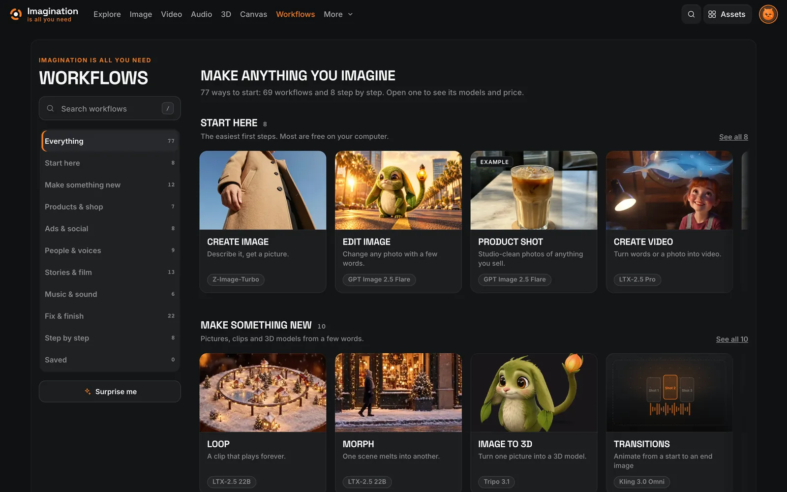
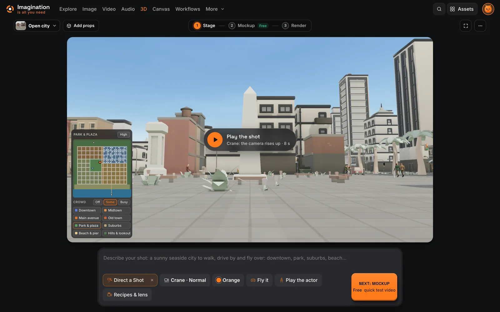

<h1 align="center">Imagination is all you need.</h1>

<p align="center"><b>One app for images, video, audio and 3D. Run it on your computer or in the cloud.</b></p>

<p align="center"><sub>ComfyUI · Comfy Cloud · Comfy Router · LTX-2.5 · MiniMax H3 · FLUX · Qwen-Image · Wan · YuE2 · Tripo · MCP</sub></p>

<p align="center">
  <a href="https://github.com/sytesims/imagination-is-all-you-need/actions/workflows/ci.yml"></a>
  <a href="LICENSE"></a>
  <a href="workflows/README.md"></a>
  <a href="docs/MCP.md"></a>
  <a href="https://iiayn.app"></a>
</p>

**Watch the demo (under 2 minutes):** [https://x.com/SyteSim/status/2117116408698134830](https://x.com/SyteSim/status/2117116408698134830)

**Challenge entry:** Comfy's Open Source Higgsfield challenge, in **Most Innovative** and the **LTX VFX bonus** (LTX is the core video model of Direct a Shot, Layout to Render and Footage Effects).

<p align="center"></p>

## Why it's new

- **You pick where each run happens, and see the real price before you press Generate.** One **Run on** control on every run: **your computer** (free, on your own ComfyUI), **Comfy Cloud** (the same open workflow on Comfy's GPUs) or **Comfy Router** (partner models such as Kling, Veo and MiniMax H3). The button shows the price for that place before anything starts.
- **A Canvas where Claude drafts with whole ComfyUI workflows.** Every card on the board is a complete workflow. Claude, over MCP, lays out the board and prices each card, and nothing runs until you press **Go**. A finished card opens the exact graph it ran in ComfyUI.
- **Block a shot in 3D, and LTX films it.** In **Direct a Shot** you place actors and a camera move in simple 3D in your browser and record a free grey mockup. LTX-2.5 22B with Lightricks' Layout to Render IC-LoRA turns it into a real shot with sound, keeping your framing and camera path. Free on your computer, or on Comfy Cloud.

## Try it in 5 minutes, no GPU

Install with the one line below. You don't need a GPU, a key or an account for this tour, and nothing is charged.

1. **Open the Examples project** (Assets → Projects → Examples). Real results made in the app, each with its model, where it ran and its price.
2. **Open a result and press View workflow.** You see the ComfyUI graph behind it, with its model and settings filled in.
3. **Press Open in ComfyUI.** The app opens your ComfyUI with the graph on the clipboard and downloaded, ready to drop on the canvas. No ComfyUI? Keep the downloaded graph.
4. **Open the Canvas and pick a starter** in the agent panel, such as **Short film from idea**. The built-in demo agent lays out the board step by step, with a whole workflow on each card. Every run waits for your Go, and with nothing connected nothing can run.

Want to see it run? Connect your ComfyUI or a Comfy key in **Settings → Connections**.

<table align="center">
  <tr>
    <td width="50%"><br><sub>Run on: pick the place, see the price first</sub></td>
    <td width="50%"><br><sub>Canvas: whole workflows chained card to card</sub></td>
  </tr>
  <tr>
    <td width="50%"><br><sub>Workflows: every way to start, in one place</sub></td>
    <td width="50%"><br><sub>Direct a Shot: block it in 3D, then film it</sub></td>
  </tr>
</table>

## Install in one line

On macOS or Linux, paste this into Terminal:

```sh
curl -fsSL https://iiayn.app/install | bash
```

On Windows, paste this into PowerShell:

```powershell
irm https://iiayn.app/install.ps1 | iex
```

It checks for git, Node.js (22, 24 or 26) and ffmpeg and asks before installing anything that is missing. Then it puts the app in an `Imagination` folder in your home folder, offers a shortcut and opens the app in your browser. It doesn't download AI models or ask for keys: you connect those in the app when you want them. Read the scripts first if you like: [get.sh](scripts/get.sh) · [get.ps1](scripts/get.ps1).

<details>
<summary><b>Other ways to install</b> (git clone, Mac Dock app, updating)</summary>

You'll need **Node.js 22, 24 or 26** (24 recommended) and npm, plus **ffmpeg and ffprobe** for media.

```text
git clone https://github.com/sytesims/imagination-is-all-you-need.git
cd imagination-is-all-you-need
npm run setup
```

Open the link printed in the terminal, normally **http://localhost:5174**. Keep the terminal open while you use the app; **Ctrl+C** stops it. Later, **`npm start`** starts it again. On Windows, use `npm.cmd run setup` if PowerShell picks a blocked `npm.ps1` shim; don't change your execution policy for it.

**Mac app (Dock):** run `npm run mac-app` once in the app folder. It puts **Imagination** in your Applications folder; clicking it starts the app in the background and opens it in your browser. More in [Install and run](docs/INSTALL.md#mac-app-dock).

**Updating:** stop the app, then run `npm run update` in the app folder. Your library, boards and keys stay as they are. `npm run update -- --check` only tells you if an update is ready. More in [Updating](docs/INSTALL.md#updating).

Other ports and advanced setups: [Install and run](docs/INSTALL.md) · [Configuration](docs/CONFIGURATION.md).

</details>

## What you can make

- **Shoot a product in every material, then turn it into ads.** **Material Swap**: “Give an object the material from another photo”; **Ad Pack** makes a set of finished ads and places your real logo from a brand kit; **Product Shot**: “Studio or lifestyle shots of a product”; **Phone Photo**: “An everyday phone photo of a made-up person”.
- **Split a picture into layers and keep editing.** **Image to layers** gives you clean, transparent layers; **Download PSD** saves them as one layered Photoshop file, named and in place.
- **Stage a shot, then film it.** **Direct a Shot** lets you place the camera and actors in simple 3D in your browser, then films it for real with LTX-2.5. Add **Camera Moves** (82 moves), **Lip Sync**, **Extend** and **Transitions**, then join clips with **Stitch**.
- **Write a song, voice a script, translate a video.** **Music** (YuE2, free on your computer), **Voiceover**, **Sound effects**, and **Translate**, which keeps the background music.
- **Turn one picture into a 3D model.** **Image to 3D**, **Text to 3D** and **Multi-view to 3D**, then a **Turntable video** of the model spinning.

Ready to use today: **69 ready-made workflows** (19 image · 38 video · 8 audio · 4 3D), including the **24 one-click apps**, plus **8 step-by-step chains**. The Workflows tab lists every one of them. Open the bundled **Examples project** to see results and how each was made; **Recreate** loads the workflow and settings, and never starts a paid run on its own.

<table align="center">
  <tr>
    <td width="50%"><br><sub>A glass whale over the dunes · LTX-2.5 Pro</sub></td>
    <td width="50%"><br><sub>A village on a tortoise's back · GPT Image 2.5 Flare</sub></td>
  </tr>
  <tr>
    <td width="50%"><br><sub>A boy and a fox, with its own sound · LTX-2.5 22B, free on your computer</sub></td>
    <td width="50%"><br><sub>Mossbun, one picture turned into a 3D model · Tripo 3.1</sub></td>
  </tr>
</table>
<p align="center"><sub>Every picture above was made in the app.</sub></p>

## Canvas: think in ideas, run in Comfy

On the Canvas each card is a whole workflow. Connect cards and a result flows into the next one: a portrait, then a character sheet of the same person, then a shot.

- **Bring your AI.** Claude (or another MCP client) can draft the board and price each card. Nothing on the Canvas runs until you press **Go**.
- **Nothing hidden.** Every finished card, like every result, has **View workflow**: for runs on your computer or Comfy Cloud, that's the exact ComfyUI graph it ran, ready to open in ComfyUI.

Canvas is in beta.

## Runs where you want

Every run picks where it happens, and the price updates before you press Go.

| Where | What runs there | Cost |
|---|---|---|
| **Your computer** | Open models on your own ComfyUI | Free |
| **Comfy Cloud** | Open workflows on Comfy's GPUs, including partner nodes | Comfy credits |
| **Comfy Router** | Partner models (GPT Image, Nano Banana, Seedance, Kling, Veo, MiniMax H3 and more) | Set price per run |

Comfy deployments are supported: connect your own from Settings.

The app reads your hardware and tells you, per local model, whether it fits, will be slow or is too heavy. You can switch to open-weights models only.

## You always see the price

- The price is shown **before** every run. Runs on your computer are free.
- Every result names the **real model** and **where it ran**.
- Hosted prices come from each provider's own price page, with the date we checked it. No markup.
- On Comfy Router the app asks for an estimate first, records the credits Comfy reports, and turns provider fallback off, so a run is never quietly sent somewhere else at a different price.

## Runs on

Labels: **Tested** = used for real generation. **Installs in CI** = the one-line install, build and startup run on every change in GitHub Actions (no GPU). **Wired, not run** = supported in the code, not yet tested on real hardware.

| Platform | Status |
|---|---|
| macOS, Apple Silicon | **Tested** by the maintainer (local and cloud runs) · **Installs in CI** |
| Windows x64 | **Installs in CI** |
| Linux x64 (incl. a fresh Ubuntu 24.04 with no Node) | **Installs in CI** |
| Linux ARM64 | **Installs in CI** |
| NVIDIA GPUs (Windows, Linux) | **Wired, not run**: supported (reads your card, right PyTorch build, only models that fit), not yet tested on real hardware |
| NVIDIA DGX Spark | **Wired, not run**: supported, not yet tested on real hardware |

Local generation uses your own ComfyUI, its model files and nodes. A model that runs in the cloud may still need more memory than your computer has. Reports from other hardware are welcome. More: [local models and hardware](docs/LOCAL-MODELS-AND-HARDWARE.md) · [models and providers](docs/PROVIDERS-AND-MODELS.md).

## How it's built

- **Three routes, one key:** your own ComfyUI, Comfy Cloud and Comfy Router, with a single Comfy key for both cloud routes. Setup: [Comfy Cloud](docs/COMFY-CLOUD-SETUP.md).
- **Official templates first:** 30 official Comfy templates bundled (in [`workflows/templates/`](workflows/templates)), over 120 credited with their source and licence. Community workflows come next, then our own.
- **Partner models** inside Comfy: LTX-2.5 Pro and Fast, Tripo 3.1, Topaz and more in Cloud graphs; GPT Image, Nano Banana, Seedance, Kling, Veo and MiniMax H3 through Comfy Router.
- **Real runs, not mock-ups:** the results on the app's Explore page come from real runs on your computer, Comfy Cloud and Comfy Router, each with its model and price.
- **Every graph is in the repo:** the ComfyUI API graphs the app runs are in [`workflows/`](workflows), the Comfy Cloud ones in [`workflows/cloud/`](workflows/cloud/README.md).

Workflow sources and licences: [workflows/README.md](workflows/README.md) · [workflows/LICENSES.md](workflows/LICENSES.md).

## Claude connector

The built-in **MCP server** has **up to 70 tools** (15 in the default set) and the repo ships **17 skills** (ad variants, product photo packs, storyboard to video, cost check, free local only and more). Your AI can find workflows, read prices, run jobs and build Canvas boards.

- Paid runs need a **price quote** first, and your permission and budget settings decide what may run.
- On the Canvas, the agent proposes and **you press Go**.

[MCP setup and permissions](docs/MCP.md) · [Skills](docs/MCP-SKILLS.md) · [REST API](docs/API.md)

## What's next

It grows with ComfyUI. Today you can bring your own ComfyUI workflow (**Your workflows → Add a workflow**): it shows up in the right tab, and the app lists the model files it needs and downloads the missing ones. Coming next:

- **Add a model:** LoRAs and fine-tunes from one Civitai or Hugging Face link, ready in the tools that can use them.
- More official Comfy templates as one-click workflows.
- Pika H3 Flex with reference pictures.

## Yours to keep, yours to change

Open source, no tracking, and your pictures and films stay in a folder on your computer. The app listens on this computer only; it holds your keys, so don't open it to your network or the internet. If you get stuck, point an AI coding agent at [AGENTS.md](AGENTS.md): it can explain the app, check what your setup is missing or connect an existing ComfyUI. Keep keys private and ask it to check with you before big downloads or paid runs.

### A note from me

I wanted a place to follow an idea from the first picture to the finished film, with the models and workflows visible along the way. This is an early version of that place. Try the examples, make something of your own, and tell me what gets in your way.

## Docs, credits and licence

- **Docs:** [Install and run](docs/INSTALL.md) · [How it works](docs/HOW-IT-WORKS.md) · [Troubleshooting](docs/TROUBLESHOOTING.md) · [Contributing](docs/CONTRIBUTING.md) · [Security](SECURITY.md)
- **Licence:** our code is **[AGPL-3.0-or-later](LICENSE)**, with the tldraw extra permission in [NOTICE](NOTICE); tldraw keeps its [own licence](licenses/tldraw-LICENSE.md).
- **Credits:** model weights are not bundled. Models, workflows, nodes and sample assets keep their own terms: [LICENSES.md](LICENSES.md) · [workflow licences](workflows/LICENSES.md) · [attribution](docs/ATTRIBUTION.md) · [asset credits](ASSETS-CREDITS.md). Check each model's own licence before you share what you make.

For a bug report, include your OS, browser, Node version, GPU if relevant, whether you used the cloud or your own ComfyUI, and the steps. **Never include keys, private prompts or personal media.**

---

Made for Comfy's **#OpenSourceHiggsfield** challenge. Imagination Is All You Need is an independent project, not affiliated with or endorsed by Higgsfield.
